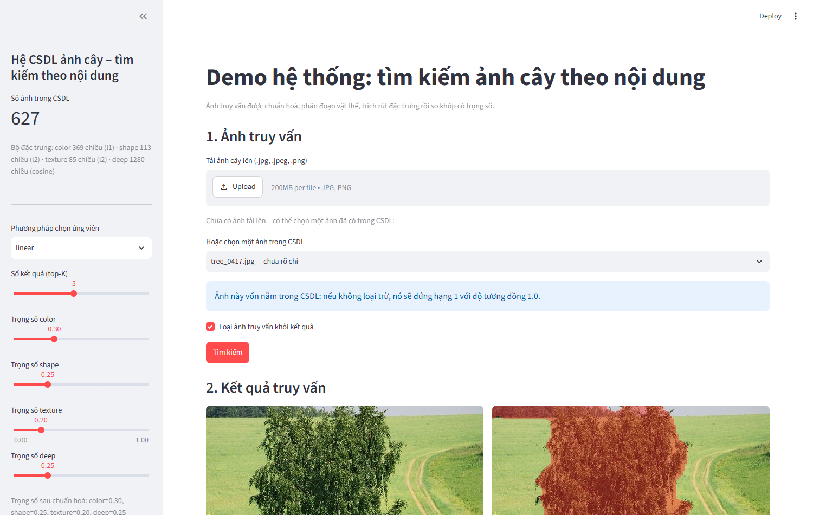
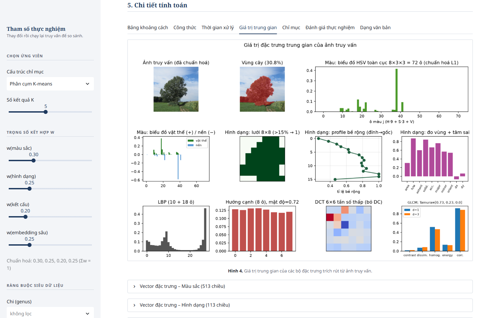

# Hướng dẫn sử dụng demo web – Hệ CSDL tìm kiếm ảnh cây theo nội dung

Tài liệu này hướng dẫn chạy và dùng giao diện web (Streamlit) của hệ thống. Chi tiết thiết kế, đặc trưng và
đánh giá xem trong `docs/BaoCao_HeCSDL_AnhCay.pdf`.

## 1. Yêu cầu

- Python 3.10 trở lên (đã thử với 3.12), Windows/Linux/macOS.
- Đã có sẵn trong repo: bộ ảnh `data/images/`, CSDL đặc trưng `db/tree_features.sqlite`, chỉ mục kd-tree và K-means.
- Lần chạy đầu cần Internet để tải model MobileNetV2 (≈14 MB) vào thư mục `models/`.
  Nếu không tải được, hệ thống vẫn chạy với 3 bộ đặc trưng thủ công (màu, hình dạng, kết cấu).

## 2. Cài đặt và khởi động

```bash
pip install -r requirements.txt
streamlit run app/streamlit_app.py
```

Trình duyệt tự mở địa chỉ `http://localhost:8501`. Nếu không tự mở, dán địa chỉ đó vào trình duyệt.
Muốn đổi cổng: `streamlit run app/streamlit_app.py --server.port 8600`.

Nếu màn hình báo "CSDL trống" thì chạy lại hai bước tạo CSDL rồi khởi động lại:

```bash
python scripts/extract_features.py
python scripts/build_index.py
```

## 3. Bố cục giao diện



Giao diện trình bày theo kiểu một bài báo khoa học: đầu trang có tiêu đề, nhóm, đoạn **Tóm tắt** và các thông số chính
của CSDL (số ảnh N, số chi có nhãn, số chiều từng bộ đặc trưng, P@5 leave-one-out). Phần chính chia thành các mục đánh
số; hình và bảng có chú thích đánh số (Hình 1, Bảng 1…), công thức hiển thị bằng LaTeX, tên chi viết nghiêng.

**Thanh bên – Tham số thực nghiệm**

| Mục | Ý nghĩa |
|---|---|
| Cấu trúc chỉ mục | quét tuyến tính (chính xác nhất), cây k-d trên PCA, cây R (8 chiều PCA, nạp lô STR), cây tứ phân PR (2 chiều PCA), phân cụm K-means |
| Số kết quả K | số ảnh trả về, mặc định 5 |
| Trọng số kết hợp w | w(màu sắc), w(hình dạng), w(kết cấu), w(embedding sâu); hệ thống chuẩn hoá để Σw = 1 và hiển thị giá trị đã chuẩn hoá |
| Ràng buộc siêu dữ liệu | chọn chi, nhóm hình thái, giấy phép; để trống = không lọc |
| Vẽ biểu đồ giá trị trung gian | bật để vẽ biểu đồ đặc trưng của ảnh truy vấn ở tab **Giá trị trung gian** |

**Phần chính**

1. **Ảnh truy vấn**: chọn *Tải ảnh lên* hoặc *Ảnh trong CSDL*, rồi bấm **Thực hiện truy vấn**.
2. **Tiền xử lý và thông số**: Hình 1 (ảnh chuẩn hoá và mặt nạ vùng cây) và Bảng 1 (thông số lần truy vấn).
3. **Kết quả**: lưới K ảnh giống nhất.
4. **Phản hồi liên quan**: công thức Rocchio và nút truy vấn lại.
5. **Chi tiết tính toán**: các tab Bảng khoảng cách, Công thức, Thời gian xử lý, Giá trị trung gian, Chỉ mục,
   Đánh giá thực nghiệm, Dạng văn bản.

## 4. Các bước truy vấn

### Cách 1: tải ảnh cây mới

1. Ở mục 1 chọn **Tải ảnh lên**, bấm **Upload** và chọn file `.jpg`, `.jpeg` hoặc `.png` (ảnh chụp ngang, một cây nằm giữa khung cho kết quả tốt nhất).
2. Bấm **Thực hiện truy vấn**.
3. Đợi khoảng 0,7–1,0 giây (bước phân đoạn SegFormer và trích rút đặc trưng chiếm phần lớn thời gian).

Mười ảnh thử không nằm trong CSDL có sẵn ở `data/queries/` để dùng ngay.

### Cách 2: chọn ảnh trong CSDL

1. Ở mục 1 chọn **Ảnh trong CSDL**, rồi chọn một ảnh trong danh sách (30 ảnh ngẫu nhiên, có ghi chi nếu biết); ảnh được xem trước ngay bên dưới.
2. Giữ tick **Loại chính ảnh này khỏi kết quả (leave-one-out)** để ảnh đó không tự đứng hạng 1 với độ tương đồng 1.0.
3. Bấm **Thực hiện truy vấn**.

### Đổi tham số

Sau khi đổi cấu trúc chỉ mục, K, trọng số hoặc ràng buộc, giao diện nhắc "Tham số vừa thay đổi"; bấm **Thực hiện truy vấn** lần nữa để chạy lại.

## 5. Đọc kết quả

- **Hình 1 – ảnh chuẩn hoá và mặt nạ vùng cây**: vùng đỏ là phần được coi là cây.
  Nếu vùng đỏ lệch nhiều (bao cả cỏ, bỏ sót tán) thì kết quả các bộ hình dạng/kết cấu sẽ kém tin cậy.
- **Bảng 1 – thông số truy vấn**: tỉ lệ vùng cây, cấu trúc chỉ mục, số ứng viên đã xét / |CSDL|, trọng số, thời gian, ràng buộc (nếu có).
- **Lưới kết quả (mục 3)**: mỗi ô ghi hạng, chi (in nghiêng), ảnh và một bảng nhỏ gồm `sim` (độ tương đồng
  `sim = 1/(1+D)`, càng gần 1 càng giống), `D` và `d̃` của từng bộ đặc trưng, cuối cùng là tên file.
- **Phản hồi liên quan (mục 4)**: dưới mỗi ảnh kết quả chọn R (liên quan) hoặc N (không liên quan), rồi bấm
  **Truy vấn lại với phản hồi**; vector truy vấn được dịch theo công thức Rocchio
  `q' = (α·q + β·tb(R) − γ·tb(N)) / (α + β − γ)` với α = 1, β = 0,75, γ = 0,25. Có thể lặp nhiều vòng.
- **Tab Bảng khoảng cách**: với mỗi ảnh kết quả
  - `sim`, `D` = Σ w × khoảng cách chuẩn hoá,
  - `d̃ <bộ>` = d/scale: khoảng cách của bộ đó đã chia cho khoảng cách trung bình giữa hai ảnh ngẫu nhiên (≈1 là "bình thường", < 1 là giống hơn mức ngẫu nhiên),
  - `w·d̃ <bộ>`: phần đóng góp của bộ đó vào D.
- **Tab Công thức**: công thức chuẩn hoá, kết hợp khoảng cách và các độ đo L1, L2, cosine.
- **Tab Thời gian xử lý**: biểu đồ thời gian từng bước load_normalize, segment, extract_*, candidates, distance_rank.
- **Tab Chỉ mục**: với `kdtree` – số chiều PCA, ứng viên và khoảng cách trong cây; với `rtree` / `quadtree` – thêm số nút
  đã duyệt; với `kmeans` – khoảng cách đến từng tâm cụm, các cụm đã quét và ứng viên.
- **Tab Đánh giá thực nghiệm**: bảng P@5, P@1, mAP@5 theo từng bộ đặc trưng, bảng so sánh các cấu trúc chỉ mục
  (recall so với quét tuyến tính, thời gian) và kết quả mô phỏng phản hồi liên quan, đọc từ `results/evaluation.json`.
- **Tab Dạng văn bản**: cùng thông tin ở dạng văn bản để sao chép vào báo cáo.

## 6. Chế độ "Vẽ biểu đồ giá trị trung gian"



Khi bật, tab **Giá trị trung gian** có thêm hình **Giá trị trung gian của các bộ đặc trưng**: biểu đồ HSV toàn cục,
biểu đồ vật thể/nền, lưới hình dạng 8×8, profile bề rộng tán, đo vùng và tâm sai, biểu đồ LBP, hướng cạnh, hệ số DCT,
GLCM và Tamura. Dù bật hay tắt, tab này luôn có một mục mở rộng cho mỗi bộ đặc trưng chứa toàn bộ giá trị các khối
(làm tròn 4 chữ số).

## 7. Tham số trên URL (tiện cho demo)

| Tham số | Tác dụng | Ví dụ |
|---|---|---|
| `auto=<tên file trong data/queries>` | tự chạy truy vấn với ảnh đó ngay khi mở trang | `http://localhost:8501/?auto=query_01.jpg` |
| `backend=linear\|kdtree\|rtree\|quadtree\|kmeans` | đặt cấu trúc chỉ mục mặc định | `?auto=query_03.jpg&backend=kmeans` |
| `debug=1` | bật sẵn "Vẽ biểu đồ giá trị trung gian" | `?auto=query_03.jpg&backend=kmeans&debug=1` |

## 8. Dùng bằng dòng lệnh (không cần web)

```bash
python scripts/query.py --image data/queries/query_01.jpg --backend linear --top-k 5 \
    --weights color=0.3,shape=0.25,texture=0.2,deep=0.25 --json ketqua.json --fig ketqua.png
```

In bảng kết quả ra màn hình, ghi toàn bộ giá trị trung gian vào `ketqua.json` và vẽ hình `ketqua.png`.

## 9. Lỗi thường gặp

| Hiện tượng | Nguyên nhân / cách xử lý |
|---|---|
| Trang báo CSDL trống hoặc thiếu chỉ mục | chạy `python scripts/extract_features.py` rồi `python scripts/build_index.py`, khởi động lại |
| `Port 8501 is already in use` | thêm `--server.port <cổng khác>` |
| Thiếu bộ `deep` trong thanh bên | model chưa tải được (không có Internet); hệ thống vẫn chạy với 3 bộ còn lại, chạy lại `extract_features.py` khi có mạng |
| Vùng cây (mask) sai nhiều | ảnh không có cây rõ ở giữa hoặc nền quá giống tán; thử ảnh khác hoặc giảm trọng số shape/texture |
| Kết quả không đổi sau khi chỉnh trọng số | phải bấm lại **Thực hiện truy vấn** |
| Ảnh tải lên bị mất sau khi tắt app | ảnh tạm được lưu ở `results/tmp/`, có thể xoá thoải mái |
